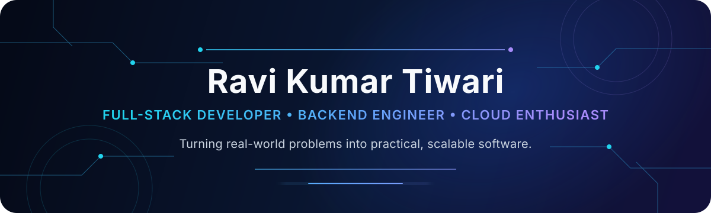

  
   
  
   
  Python & Django · React & Next.js · PostgreSQL · REST APIs · AWS
    
  
  
  

## About Me

I'm a Computer Science Engineering student at SRM University Delhi-NCR, Sonipat, and a developer who enjoys taking products from an initial idea to a working system. My practical experience spans full-stack applications, backend services, database integration, authentication, and web deployment.

I have worked on campus printing workflows, property technology, CRM and email automation, e-commerce, satellite-imagery analysis, content systems, and cloud-hosted applications. I care about building software that is useful, secure, maintainable, and clear enough for a team to keep improving.

> **In short:** I build practical products with a backend-first mindset and an eye toward reliable cloud delivery.

### Quick Facts

- 🎓 **Education:** B.Tech in Computer Science and Engineering, SRM University Delhi-NCR, Sonipat (2023–2027)
- 💼 **Experience:** Backend Developer Intern at GenVilla
- ☁️ **Cloud learning:** AWS Academy Graduate — Cloud Foundations
- 🧭 **Interests:** full-stack development, backend engineering, cloud, SaaS, and practical AI integration
- 🤝 **Collaboration:** open to meaningful development, open-source, and startup opportunities
- 🗣️ **Languages:** English and Hindi

## GitHub Snapshot

  
  
  

Repository, star, and fork totals come from the public GitHub API. Star and fork totals exclude the profile repository, archived repositories, and forks.

## Technical Arsenal

I use the tools that fit the product and problem; this curated list reflects technologies I have worked with or am actively developing with.

| Area | Technologies |
|---|---|
| **Programming** | Python · JavaScript · TypeScript · C · C++ · SQL |
| **Frontend** | React · Next.js · HTML5 · CSS3 · Tailwind CSS · Bootstrap |
| **Backend** | Django · Django REST Framework · Flask · FastAPI · Node.js · REST APIs |
| **Data** | PostgreSQL · MySQL · MongoDB · SQLite · PostGIS |
| **Cloud & delivery** | AWS · EC2 · Cloudflare · Render · Vercel · Nginx · Gunicorn |
| **Developer tools** | Git · GitHub · VS Code · Linux · Docker |
| **Additional experience** | Cloudinary · Google Earth Engine · IBM SPSS |

  
  &nbsp;
  
  &nbsp;
  
  &nbsp;
  

### Languages Used Across My Public Repositories

| Language | Share of detected repository code |
|---|---:|
| JavaScript | 34.0% |
| HTML | 29.6% |
| Python | 19.8% |
| CSS | 14.7% |
| TypeScript | 1.9% |
| PowerShell | 0.1% |

GitHub language usage describes repository composition, not proficiency or mastery.

## Featured Projects — From Ideas to Working Systems

### [Bookloom](https://github.com/Ravi-Tiwari-23/Book-formatter) · Document Engineering

**A local, source-faithful PDF-to-book production workspace with approval and quality gates.**

**Stack:** `Python` `Streamlit` `PyMuPDF` `Tesseract OCR` `WeasyPrint` `pypdf` `pytest`
 
**GitHub metadata:** Python · ★ 0 · Forks 0 · Last activity 12 Oct 2026 · **Curated status:** Active development
 
[Repository](https://github.com/Ravi-Tiwari-23/Book-formatter)
### [GenVilla / Your Home](https://github.com/Ravi-Tiwari-23/estate_v2) · PropTech

**Property exploration and financial decision support for home buyers.**

**Stack:** `Next.js` `React` `JavaScript` `Tailwind CSS` `React Query` `Recharts`
 
**GitHub metadata:** JavaScript · ★ 0 · Forks 0 · Last activity 28 Aug 2026 · **Curated status:** Product development
 
[Repository](https://github.com/Ravi-Tiwari-23/estate_v2) · [Verified live demo](https://your-home-flame.vercel.app)
### [Portfolio & Project CMS](https://github.com/Ravi-Tiwari-23/personal_portfolio) · Full-Stack Application

**A production-oriented portfolio with a focused private administration layer.**

**Stack:** `Flask` `SQLAlchemy` `PostgreSQL` `Cloudinary` `Gunicorn` `Docker` `pytest`
 
**GitHub metadata:** Python · ★ 0 · Forks 0 · Last activity 10 Sep 2026 · **Curated status:** Active development
 
[Repository](https://github.com/Ravi-Tiwari-23/personal_portfolio)
### [Zara It](https://github.com/Ravi-Tiwari-23/ZaraTech-blog_page) · Content Platform

**A role-aware Django publishing application for posts, categories, comments, search, and users.**

**Stack:** `Django` `Python` `Bootstrap` `SQLite` `Pillow`
 
**GitHub metadata:** Python · ★ 0 · Forks 1 · Last activity 12 Oct 2026 · **Curated status:** Active development
 
[Repository](https://github.com/Ravi-Tiwari-23/ZaraTech-blog_page)

<strong>More product work</strong>

 

- **Printeze — Campus Printing SaaS:** QR-based uploads, anonymous submissions, shop dashboards, print-job workflows, reporting, and privacy-conscious document handling. `Django` `PostgreSQL` `AWS EC2` `Gunicorn` `Nginx` · **Repository not publicly listed**
- **Connectra — CRM & Email Automation:** Multi-workspace outreach with roles, campaigns, backend APIs, queue architecture, and Gmail OAuth integration work. `Next.js` `Django REST Framework` `PostgreSQL` `Gmail API` · **In development; repository not publicly listed**
- **Falcon Eye — Geospatial Analytics:** Area-of-interest management and satellite analysis using vegetation, water, and land-cover indices. `Next.js` `Node.js` `PostgreSQL` `PostGIS` `Google Earth Engine` · **Repository not publicly listed**
- **Printezy.shop — Custom Merchandise:** An e-commerce product covering catalog, storefront, customization, seller, cart, wishlist, order, and administrative workflows. `Next.js` `TypeScript` `FastAPI` `PostgreSQL` `Tailwind CSS` · **In development; repository not publicly listed**

## Recently on GitHub

No meaningful recent public activity is available from GitHub's public events window.

GitHub's public-events API has a limited retention window. Repetitive pushes are deduplicated, and profile-automation commits are excluded.

## Experience & Recognition

### Backend Developer Intern · GenVilla

Contributed to practical product requirements across application and API development, data and backend workflows, feature delivery, debugging, and collaboration. The experience strengthened my understanding of building software inside an evolving real-world product rather than as an isolated technical exercise.

### AWS Academy Graduate — Cloud Foundations

Foundational study in AWS cloud concepts, services, security, architecture, pricing, and support.

### Cosmicathon Hackathon — Top 10 Team

Top 10 team at Cosmicathon, TIET Patiala, August 2026.

## What I'm Building & Learning

- Production-ready backend services with cleaner APIs and data models
- Better system design, testing strategy, and application security
- AWS deployment patterns and maintainable cloud infrastructure
- Practical AI integrations that improve a product instead of adding novelty
- Scalable SaaS workflows, observability, and dependable delivery

## GitHub Engineering Activity

  <picture>
    <source media="(prefers-color-scheme: dark)" srcset="https://github-readme-stats.vercel.app/api?username=Ravi-Tiwari-23&amp;show_icons=true&amp;hide_border=true&amp;rank_icon=github&amp;title_color=60A5FA&amp;icon_color=22D3EE&amp;text_color=CBD5E1&amp;bg_color=00000000" />
    
  </picture>
  <picture>
    <source media="(prefers-color-scheme: dark)" srcset="https://github-readme-stats.vercel.app/api/top-langs/?username=Ravi-Tiwari-23&amp;layout=compact&amp;hide_border=true&amp;langs_count=8&amp;title_color=60A5FA&amp;text_color=CBD5E1&amp;bg_color=00000000" />
    
  </picture>
   
  <picture>
    <source media="(prefers-color-scheme: dark)" srcset="https://streak-stats.demolab.com?user=Ravi-Tiwari-23&amp;hide_border=true&amp;background=00000000&amp;ring=22D3EE&amp;fire=A78BFA&amp;currStreakLabel=60A5FA&amp;sideLabels=CBD5E1&amp;dates=94A3B8&amp;sideNums=E2E8F0&amp;currStreakNum=E2E8F0" />
    
  </picture>

## 🐍 My Contribution Journey

The contribution animation is generated automatically and will appear here after its first successful publication.

## Developer Philosophy

> Good software earns its complexity. The goal is not to use the most technologies—it is to solve a real problem clearly, reliably, and in a way the next developer can maintain.

## Let's Build Something Useful

I'm interested in backend, full-stack, cloud, SaaS, and early-stage product opportunities where thoughtful engineering can make a measurable difference.

  <a href="mailto:ravi.tiwari2303@gmail.com"><strong>Email me</strong></a>
  &nbsp;·&nbsp;
  <a href="https://github.com/Ravi-Tiwari-23"><strong>Explore my GitHub</strong></a>
  &nbsp;·&nbsp;
  <a href="https://github.com/Ravi-Tiwari-23/personal_portfolio"><strong>View portfolio source</strong></a>

Thanks for visiting. If a project here connects with what you're building, I'd be glad to talk.

